# Bookmark Bar 2 Baris

Ekstensi Chrome: bookmark bar dalam 2 baris, dengan **status online server**, **pencarian cepat**,
**profil Kerja / Pribadi**, dan edit bookmark langsung dari bar. Dibuat untuk kerja IT sehari-hari.

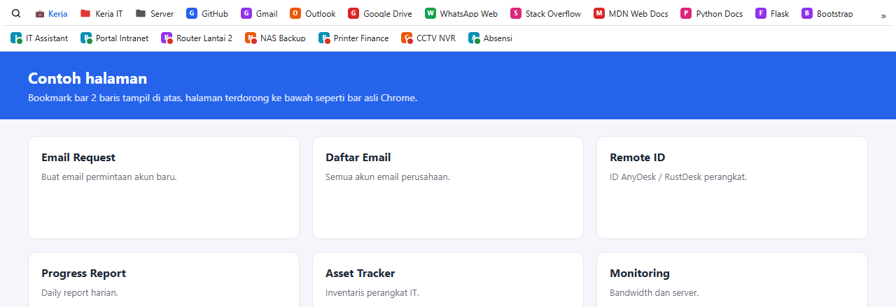

Baris 1 berisi bookmark bar biasa; baris 2 berisi folder pilihan (di sini "Perangkat Kantor").
Titik **hijau** = perangkat menjawab, **merah** = mati atau tidak menjawab.

## Fitur

| | |
| --- | --- |
| **Status server** – bookmark ke alamat lokal (192.168.\*, 10.\*, localhost, \*.local) dicek tiap menit. | **Baris 2 dari folder pilihan** – dua bar terpisah, bukan sekadar bookmark yang meluber. |
| **Pencarian cepat** – <kbd>Alt+Shift+F</kbd> atau 🔍, ketik beberapa huruf, Enter. Termasuk isi semua folder. | **Klik kanan** – edit, hapus, salin alamat, buka di Incognito; folder: ganti nama, warna, hapus. |
| **Drag & drop** – susun ulang bookmark, masukkan ke folder, atau seret link dari halaman ke bar. | **Ikon huruf berwarna** – untuk bookmark tanpa ikon (alamat IP, aplikasi lokal). |
| **Warna folder** – 8 warna, plus emoji di nama folder (mis. 🔴 Server). | **Profil Kerja / Pribadi** – satu klik (<kbd>Alt+Shift+P</kbd>) atau otomatis sesuai jam kerja. |
| **Backup pengaturan** – ekspor / impor ke file JSON. | **Tema terang / gelap**, ikon saja, 1–4 baris, posisi dorong / melayang / muncul saat mouse di atas. |

| Pencarian cepat | Menu folder dan subfolder |
| --- | --- |
| 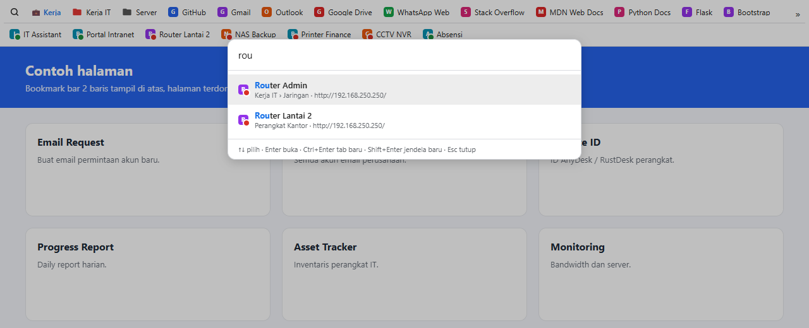 | 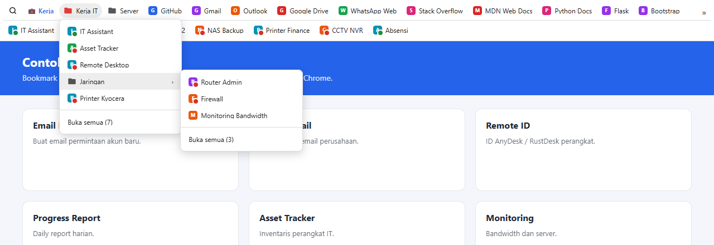 |

| Klik kanan folder (warna) | Klik kanan bookmark |
| --- | --- |
| 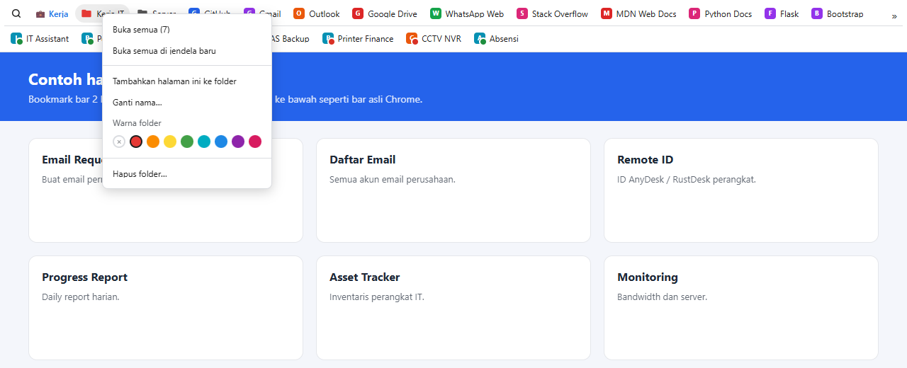 | 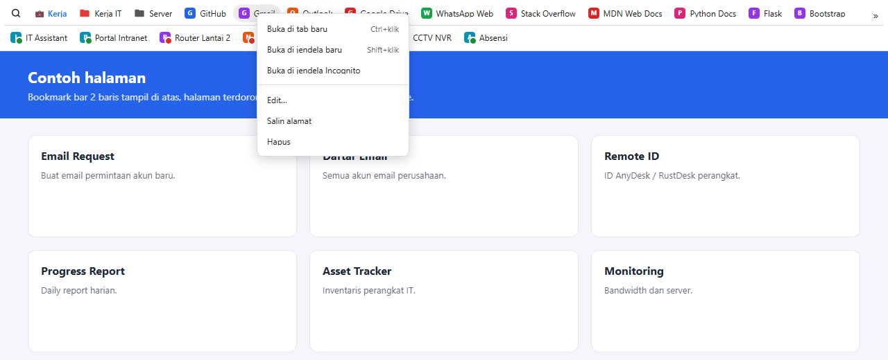 |

| Profil Pribadi | Tema gelap |
| --- | --- |
| 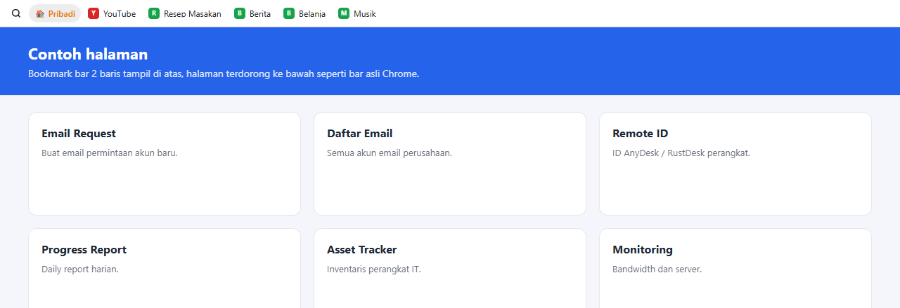 | 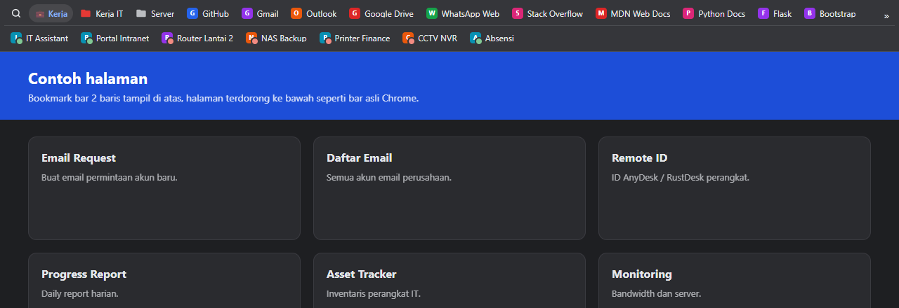 |

| Ikon saja | Tombol » untuk yang tidak muat |
| --- | --- |
| 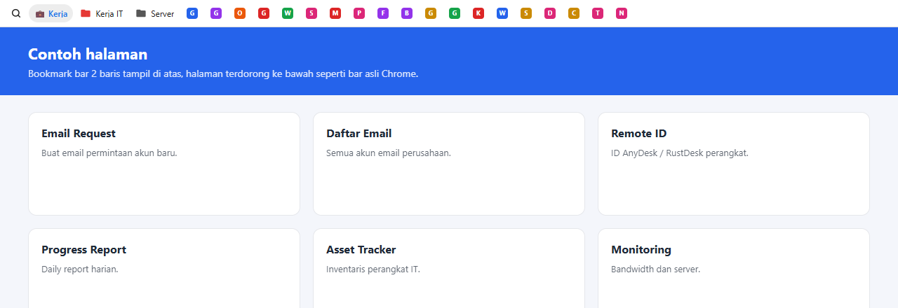 | 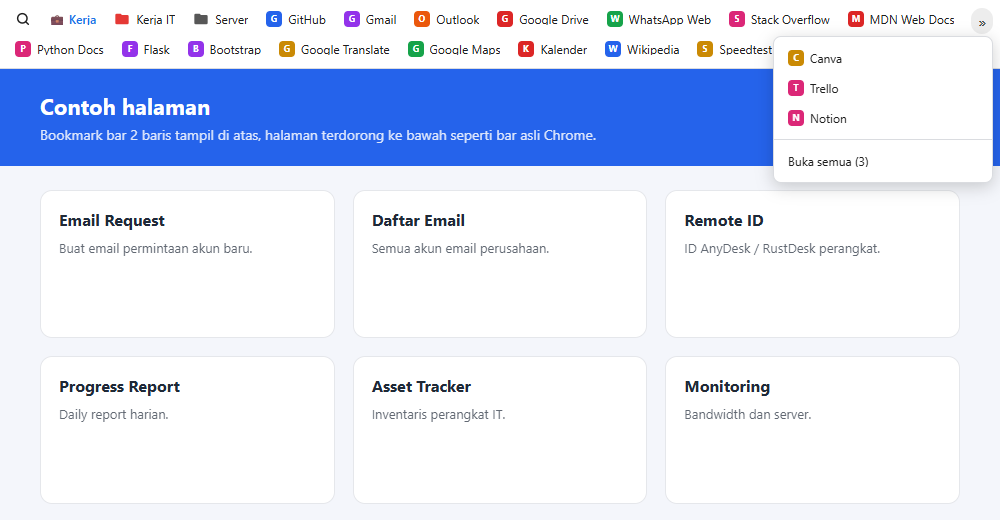 |

Edit bookmark dan halaman pengaturan

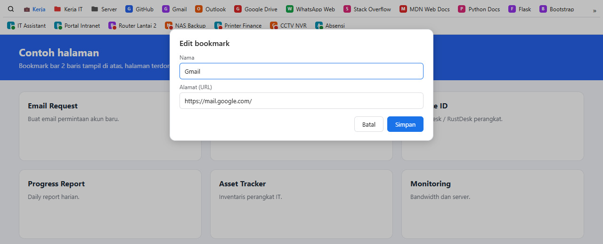

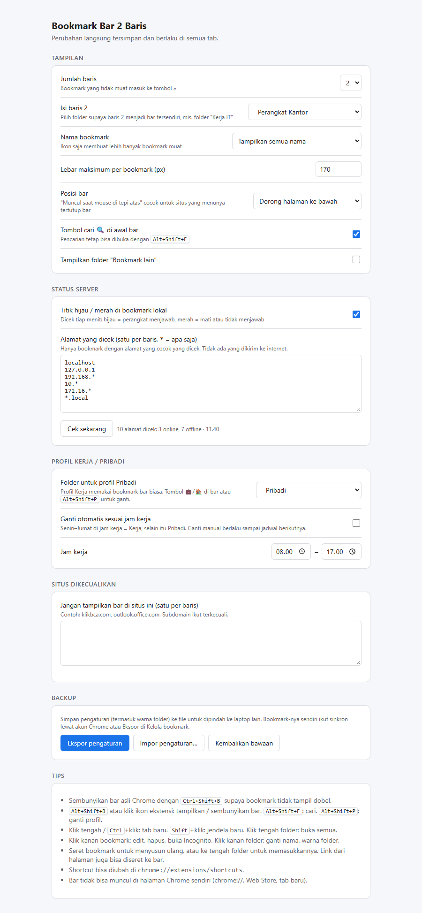

> Gambar memakai bookmark contoh, bukan bookmark asli.

## Privasi

- Tidak ada koneksi ke internet, tidak ada analitik, tidak update otomatis (dipasang lokal).
- Fitur status hanya mengetuk alamat bookmark yang cocok dengan daftar di pengaturan
  (bawaan: alamat lokal). Bisa dimatikan.
- Izin: `bookmarks`, `storage`, `favicon`, `alarms` (jadwal cek status tiap menit).
- Bar dibuat di shadow DOM tertutup: situs yang dibuka tidak bisa membaca bookmark Anda, dan
  ekstensi tidak membaca isi halaman (hanya judul + alamat saat Anda memilih "Tambahkan halaman ini").

## Pasang

1. Unduh zip di [Releases](../../releases/latest), lalu ekstrak ke folder tetap (jangan di Downloads).
2. Buka `chrome://extensions`, nyalakan **Developer mode** (kanan atas).
3. Klik **Load unpacked**, pilih folder `bookmark-bar-2-baris` (yang berisi `manifest.json`).
4. Tekan <kbd>Ctrl+Shift+B</kbd> untuk menyembunyikan bar asli Chrome.

Update: ganti isi folder dengan versi baru, lalu klik ↻ di kartu ekstensi pada `chrome://extensions`.

## Pakai

- Klik: buka di tab ini. Klik tengah / <kbd>Ctrl</kbd>+klik: tab baru. <kbd>Shift</kbd>+klik: jendela baru. Klik tengah folder: buka semua.
- <kbd>Alt+Shift+B</kbd> atau klik ikon ekstensi: tampilkan / sembunyikan. <kbd>Alt+Shift+F</kbd>: cari. <kbd>Alt+Shift+P</kbd>: ganti profil.
- Klik kanan area kosong bar: tambahkan halaman ini, folder baru, cek status sekarang, pengaturan.
- Shortcut bisa diubah di `chrome://extensions/shortcuts`.

Bar tidak bisa tampil di halaman Chrome sendiri (`chrome://`, Web Store, tab baru), dan grup tab
yang disimpan tidak bisa ditampilkan (Chrome tidak memberi akses ke ekstensi).
